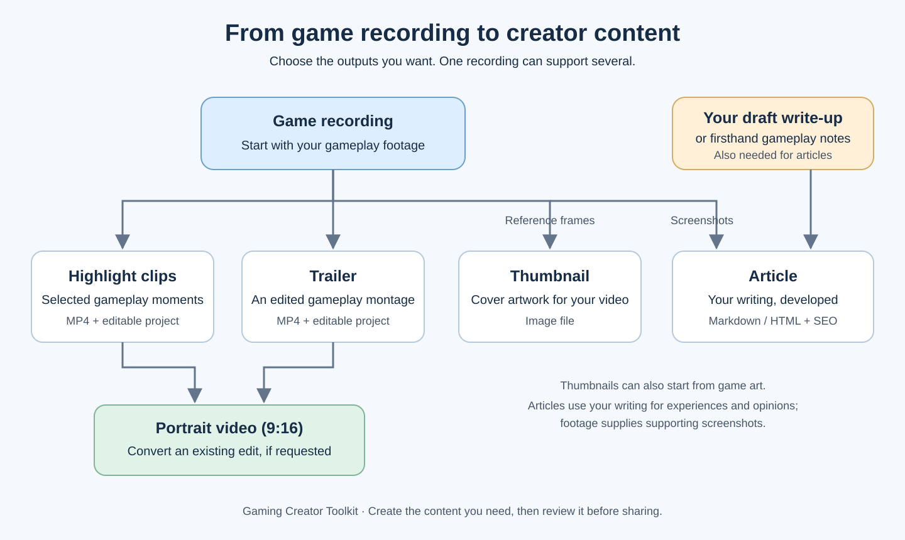

# Gaming Creator Toolkit

Created by [anasabaziz](https://github.com/anasabaziz).

Five reusable AI skills for gaming creators: find highlights, assemble trailers, reframe edits for portrait, create thumbnails, and write evidence-supported articles. Includes shared media tools, editable Shotcut projects, production checklists, recovery records and an optional local dashboard.

**Start with customization.** Your AI asks about your audience, style, tools and workflow before production, then saves confirmed settings locally. This repository contains neutral templates and fictional examples; it includes no preconfigured channel identity, branding, footage or job history. The toolkit creator credit does not configure your channel profile.

**Release status: candidate.** Windows, macOS and Linux are release targets. See [validation status](setup/validation.md) for checks actually performed and remaining release gates. Platform setup documentation is not proof of successful execution in that application.

## From recording to outputs

Start with a **game recording**. For articles, also provide **your draft write-up or firsthand gameplay notes**.



See the [simple process flowchart and editable diagram](examples/process-flow.md).

## The five skills

| Skill | Provide | Receive |
| --- | --- | --- |
| [gameplay-highlights](skills/gameplay-highlights/SKILL.md) | Gameplay recordings, desired moments/count | Selected MP4 clips, Shotcut projects, selection evidence and report |
| [gameplay-trailers](skills/gameplay-trailers/SKILL.md) | Recording or existing selections, duration and required coverage | Trailer, timing-editable Shotcut project and timeline/report |
| [horizontal-to-vertical](skills/horizontal-to-vertical/SKILL.md) | Existing edit and explicit portrait request | Portrait export/project with reviewed crops or synchronized panels |
| [game-thumbnails](skills/game-thumbnails/SKILL.md) | Game-art references or existing thumbnail, dimensions and brief | Saved artwork, generation brief and correction history; requires image integration |
| [gameplay-articles](skills/gameplay-articles/SKILL.md) | Firsthand notes, site preferences and footage when screenshots are required | Matching Markdown/HTML, authentic screenshots, SEO metadata and a private editorial report |

A trailer can start directly from a recording. Article work can reuse the same reviewed evidence without rendering video. Portrait output is created only when requested. `_video-shared` is supporting infrastructure, not a sixth skill.

## Quick start

1. Fork or download this repository into its own folder. Open that folder as the AI project's root, rather than an unrelated creator's workspace.
2. Install Python 3.10 or newer and create a virtual environment:

   ```text
   python -m venv .venv
   ```

   Activate it: Windows PowerShell uses `.venv\Scripts\Activate.ps1`; macOS/Linux use `source .venv/bin/activate`. If your system uses `python3`, use it for environment creation; after activation, `python` points to the environment. A platform's execution policy may require invoking the environment's Python directly. Then install the base dependencies:

   ```text
   python -m pip install -r requirements.txt
   ```
3. Follow the [Codex](setup/platform-guides/codex.md), [Claude Code](setup/platform-guides/claude-code.md) or [Grok](setup/platform-guides/grok.md) guide. Install the relevant project adapters:

   ```text
   python scripts/install.py --platform codex
   python scripts/install.py --platform claude
   ```

   Choose your application, or use `--platform all` for both. This writes local discovery adapters only. It does not install applications, enable services or configure your creator identity.
4. Run `python scripts/doctor.py`. For video work install FFmpeg/FFprobe and Shotcut/MLT as described in [dependencies](setup/dependencies.md). A missing video tool need not block article planning.
5. Ask your AI:

   > Read AGENTS.md and setup/onboarding.md. Help me customize this toolkit for my gaming channel. Ask only the questions relevant to the outputs I want. Summarize my answers and wait for my confirmation before saving the profiles or producing content.

Your confirmed profiles live in `.creator-toolkit/`, ignored by Git. The five skills check this setup even when called directly. Installation and documentation remain usable before customization. See [onboarding](setup/onboarding.md) for the confirmation format and updating preferences.

## Example requests

- “Find three meaningful highlights from this recording, keeping the setup and payoff. Preserve game audio.”
- “Create a 60-second trailer showing exploration, upgrades and the boss encounter. Use the supplied recording.”
- “Convert this approved trailer to 9:16 without losing the HUD or changing its timing.”
- “Create a text-free 16:9 thumbnail using these game-art references. Match the illustrated style.”
- “Turn my demo notes into an article with authentic screenshots from this recording. Do not invent opinions or playtime.”

For related outputs, request them together so selections and evidence can be reused. See [fictional examples](examples/briefs.md).

## Requirements and application differences

The instructions are portable; execution depends on the tools available in your session. Codex and Claude Code discover local skills through different directories. Grok has its own custom-skill/library workflow; do not assume uploading a single `SKILL.md` installs its Python dependencies. Each guide includes official documentation links and known verification limits.

An AI subscription alone does not install Python/video software, provide filesystem access, enable image-generation APIs or establish listening/GUI capability. No API key is required by the local renderer or dashboard. An optional connected service may have its own charges; configure it explicitly. Never put credentials in profiles or source control.

## Production checks, reviews and dashboard

Shared checklists bind evidence to exact revisions. Rendering success does not prove a good selection, readable portrait framing, smooth audio or a usable project. When a method is unavailable, the AI reports it and gives the human the relevant verification checklist. It must not claim an unperformed check passed.

Independent subagent review is optional and starts only when you request it. Human review, production completion and your acceptance are recorded separately. The [generic reviewer brief](optional/review/reviewer-brief.md) works without a named vendor-specific reviewer.

The optional [dashboard](optional/dashboard/README.md) creates a local XLSX workbook, preserves saved human decisions and lists outstanding checks. It uses openpyxl and makes no AI calls. Enable it during customization; it is not required to use the five skills.

## Files, privacy and updates

- `skills/`: canonical instructions and shared helpers.
- `templates/` and `setup/`: neutral profile templates, onboarding and platform guidance.
- `scripts/`: installation, configuration, capability checks, validation and release packaging.
- `optional/`: dashboard and independent review guidance.
- `examples/` and `tests/`: fictional/synthetic material only.

Keep personal configuration in `.creator-toolkit/`, production in `jobs/`, and dashboard state in `tracking/`. All are ignored and excluded from the allowlisted release ZIP. Put private references/media in ignored folders or outside the repository. `.gitignore` does not untrack already committed data; check staged files before pushing.

To update, preserve these local folders, update canonical source files, run relevant dependency installation and rerun the adapter installer. It refuses to overwrite unknown or locally modified adapters. Modify `skills/`, not generated adapters. Profile changes are detected and require confirmation; no update erases your existing settings. See [CONTRIBUTING](CONTRIBUTING.md).

## Limits

The renderer currently supports SDR square-pixel unrotated footage, timed trims, CFR output, static crops/panels and the effects documented in [composition](skills/_video-shared/composition.md). Shotcut timing is editable; framing/effects are baked into cached segment media. Keep those dependencies with the project. HDR, animated crop tracking, native editable effects and general transitions are not implied. Native image-generation dimensions vary and must be checked. No process automatically publishes to a CMS/social platform, refreshes article archives, deletes media or starts backups.

## License and first publication

[MIT](LICENSE) permits reuse, modifications, commercial use and closed-source derivatives while retaining its copyright and permission notice. You do not have to publish your modifications. See [third-party notices](THIRD_PARTY_NOTICES.md) for separately installed dependencies and asset rights.

The original copyright holder is [anasabaziz](https://github.com/anasabaziz), as recorded in the license. Forks retain that original notice.

For manual upload to GitHub under [anasabaziz](https://github.com/anasabaziz), upload this folder's contents at the repository root, including `.github/` and `.gitignore`. No ZIP or `dist/` folder is needed. Follow [release readiness and manual upload](setup/release.md). The toolkit remains a release candidate until its documented checks pass; no GitHub repository or external upload is created by these scripts.
