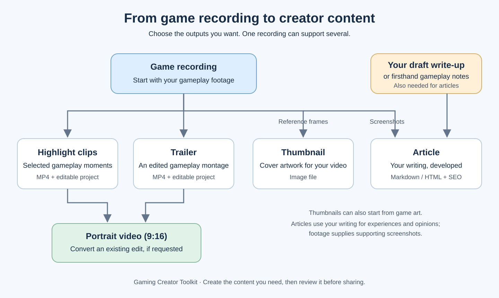
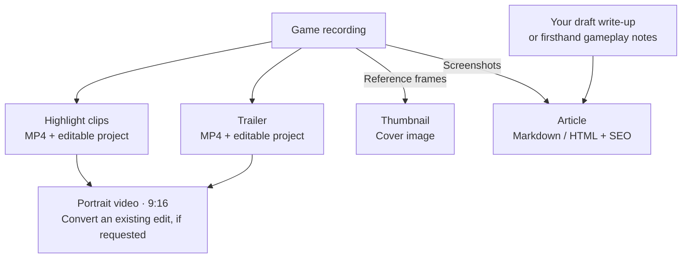

# From game recording to creator content

Start with a **game recording**. For an article, also provide **your draft write-up or firsthand gameplay notes** so your experiences and opinions guide the writing.

## Editable flowchart

Choose any outputs you need; you do not have to make them all. A trailer can start directly from the recording. Thumbnails can also use supplied game art. Articles can be developed from your writing alone when footage screenshots are not required. Review the finished content before sharing.
